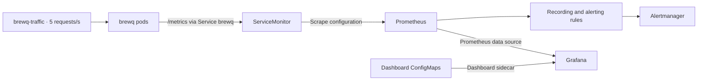

# brewq-observability

This repo monitors the brewq coffee-order service in a local kind cluster.
Prometheus scrapes the service and evaluates SLO rules. Grafana shows the
service and its error budgets. Alertmanager shows active alerts.



## The series

1. [brewq-service](https://github.com/Mythicc123/brewq-service) provides the Go API, metrics and load generator image.
2. [brewq-k8s](https://github.com/Mythicc123/brewq-k8s) creates the kind cluster, gateway and brewq release.
3. **brewq-observability** installs monitoring, dashboards and alerts.
4. [brewq-gitops](https://github.com/Mythicc123/brewq-gitops) manages releases with Argo CD and runs failure drills.

## Quick start

For the manual Helm path, run `make up` and `make deploy` in brewq-k8s
before installing monitoring. For GitOps, use the
[brewq-gitops quick start](https://github.com/Mythicc123/brewq-gitops#quick-start)
to install Brewq and monitoring together. Both paths use the public
`ghcr.io/mythicc123/brewq-service:0.1.0` image.
Install Helm 4, kubectl, Make, OpenSSL, curl and jq. Set `KUBECONFIG` if the
kind context is in a separate file. Confirm it points to the brewq cluster
before installing.

```sh
kubectl config current-context
make install
make urls
make grafana-password
```

Open Grafana at `http://grafana.localtest.me`. The initial username is
`admin`. Use `make grafana-password` to read the password from the
`grafana-admin` Secret. On first install, allow a couple of minutes for
Prometheus to reload the Brewq configuration and collect enough samples
for the recording rules. Check that at least two Brewq pod targets are up
at `http://prometheus.localtest.me/targets`, then open the dashboards
listed below. Run `make alerts` to list firing alerts. Alertmanager is at
`http://alertmanager.localtest.me`.

If the Gateway is unavailable, run `make port-forward-grafana`,
`make port-forward-prometheus` or `make port-forward-alertmanager` in a
separate terminal. Use local ports 3000, 9090 and 9093 respectively. To
list alerts through the Prometheus port-forward, run
`make alerts PROMETHEUS_URL=http://localhost:9090`.

## Service-level objectives

Both objectives use a rolling 30-day window. The request counts exclude
`/healthz`, `/readyz` and `/metrics`.

- **Availability.** At least 99.5% of requests return a response outside the 5xx range. The error budget is 0.5% of requests.
- **Latency.** At least 99% of requests finish within 300 ms. The error budget is 1% of requests. The histogram has a bucket at exactly 300 ms.

A burn rate of 1× spends the budget at the rate the objective allows.
Each row is one branch of an alert. Both windows in that row must
exceed its factor. Either row for a given alert can trigger it.

| Alert | Long / short | Burn factor | 30d budget spent at firing¹ | Time to fire at 30% bad requests¹ |
| --- | --- | ---: | ---: | ---: |
| `BrewqAvailabilityBurnFast` | 1h / 5m | 14.4× | ≈2.3% | ≈16.4 min |
| `BrewqAvailabilityBurnFast` | 6h / 30m | 6× | ≈5.3% | ≈38 min |
| `BrewqAvailabilityBurnSlow` | 1d / 2h | 3× | ≈10.7% | ≈77 min |
| `BrewqAvailabilityBurnSlow` | 3d / 6h | 1× | ≈10.7% | ≈77 min |
| `BrewqLatencyBurnFast` | 1h / 5m | 14.4× | ≈2.1% | ≈30.8 min |
| `BrewqLatencyBurnFast` | 6h / 30m | 6× | ≈5.1% | ≈74 min |
| `BrewqLatencyBurnSlow` | 1d / 2h | 3× | ≈10.3% | ≈149 min |
| `BrewqLatencyBurnSlow` | 3d / 6h | 1× | ≈10.3% | ≈149 min |

¹ Each row assumes steady traffic, a full healthy window before the change
and a step to 30% 5xx for availability or 30% over 300 ms for latency.
Times include the 2m page or 5m ticket hold and exclude scrape and
evaluation rounding. Budget spent is the incident's share of a full
30-day budget at constant traffic. The window thresholds alone correspond
to 2%, 5%, 10% and 10%, respectively, before the holds.

**Bad release drill.** At 30% 5xx, the service burns availability budget
at `0.30 / 0.005 = 60×`. The 1h ratio crosses 14.4× after about
`60 min × 14.4 / 60 = 14.4 min`. The 5m ratio has already crossed.
With six hours of healthy history, expect the page about **16–17 minutes
after the service reaches 30% errors**. The rule test fires at 16m30s.
With less history the 6h branch can fire sooner. A rolling update
can delay the point at which the aggregate reaches 30%.

The rules also page after two minutes of crash-loop evidence or two
minutes with no healthy brewq scrape target. An OOM kill raises a
ticket-severity alert. Alerts link to drill runbooks in brewq-gitops.

## Dashboards and rule source

- **Brewq Overview** (`brewq-overview`) shows traffic, 5xx responses,
  p50/p90/p99 latency, in-flight requests, queued orders, pod phases,
  restarts and container resource usage against configured limits.
- **Brewq SLOs** (`brewq-slo`) shows current SLIs, budget remaining,
  burn rates for all seven windows and pending or firing alerts.

The chart reads dashboards from [its dashboard directory](charts/brewq-monitoring/dashboards).
Grafana discovers their ConfigMaps and uses the provisioned `prometheus`
data source. The single rule source is
[brewq-slo.rules.yaml](charts/brewq-monitoring/files/brewq-slo.rules.yaml).
Helm wraps this file as a PrometheusRule and `promtool` tests the same file.

## Design and trade-offs

- Prometheus keeps seven days on `emptyDir`. The 30-day budget uses
  only available samples since the cluster started, capped at seven
  days. Replacing the Prometheus pod resets its history.
- The stack skips etcd, the scheduler, the controller manager and
  kube-proxy scrapes because default kind does not expose their metrics
  in a form the chart can scrape. Kubelet, cAdvisor, CoreDNS,
  kube-state-metrics and node exporter provide the remaining signals.
- Docker Desktop kind nodes share the VM clock. The stack disables the
  per-node `NodeClockNotSynchronising` alert because the guest kernel
  reports NTP as unsynchronised even when the nodes agree with the Mac.
  During the local test, Prometheus briefly reported
  `PrometheusMissingRuleEvaluations` and duplicate rule timestamps while
  the VM clock was making small corrections. The warning cleared after
  scheduled evaluations stabilised.
- The load generator sends five requests per second by default. Set
  `trafficGenerator.enabled=false` when using other traffic.
- Prometheus discovers rules and monitors across namespaces. The local
  Gateway uses HTTP and Prometheus and Alertmanager have no sign-in.
  These settings suit a single-user lab.
- With no request samples, the request-based SLIs are unavailable.
  A separate target alert detects loss of all healthy brewq scrapes.

Run `make lint` with Helm 4.3.2, kubeconform 0.8.0, promtool 3.16.0 and
jq. It renders both charts, validates the manifests and checks the
alert fixtures and dashboard JSON. It can run without a cluster.

## Cost: $0

The stack runs in local kind. Alerts are visible in Alertmanager without
a notification service. `make uninstall` removes both Helm releases.
Helm leaves the namespace, the Grafana Secret and its CRDs. Run
`make down` in brewq-k8s to delete the whole cluster.

## Next steps

Run the failure drills in brewq-gitops and record the observed timings.
For a full 30-day view, give Prometheus persistent storage and retain
at least 30 days of samples.
